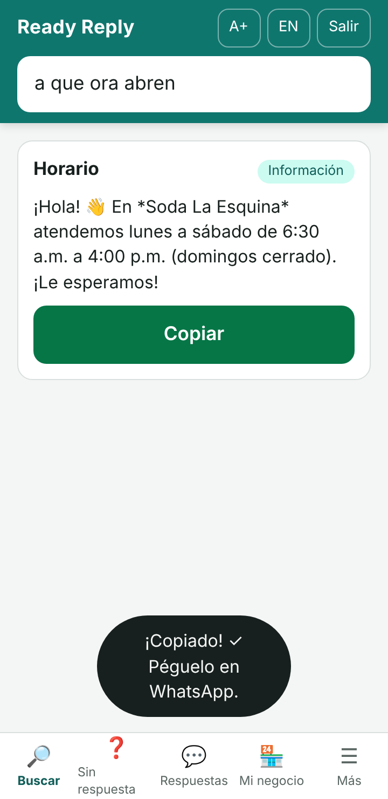
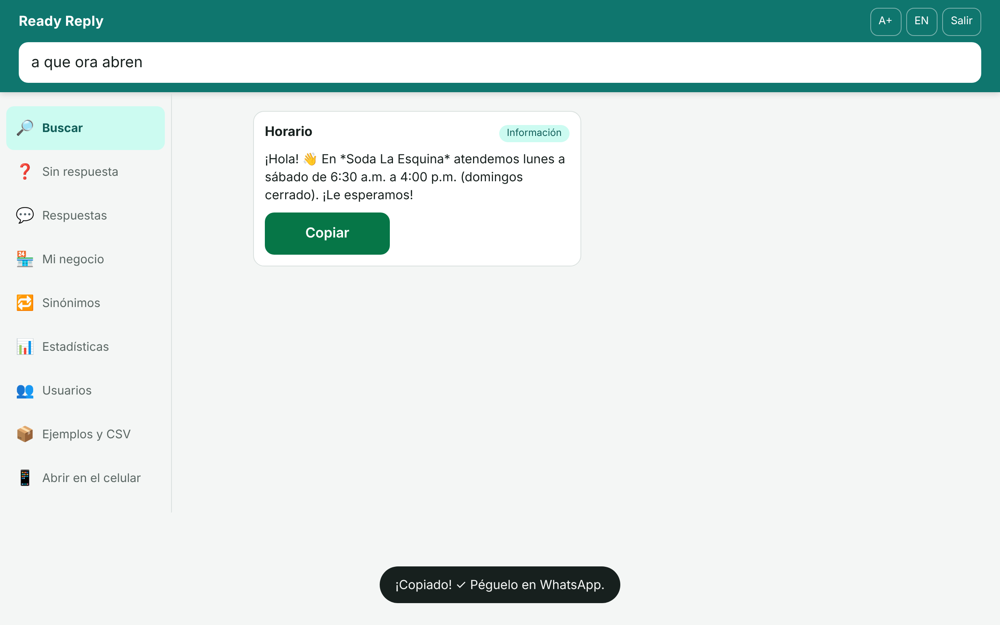
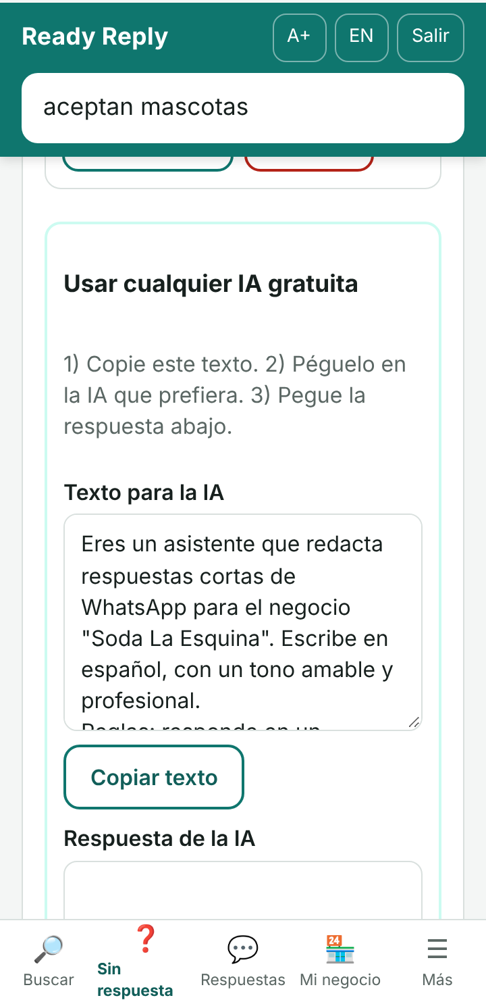

# Ready Reply

**Ready-made answers for small businesses that serve customers on WhatsApp.**

Search → copy → paste into WhatsApp. Done in 2 seconds.

| Phone | Desktop |
|---|---|
|  |  |

## The problem

Small businesses in Costa Rica and Latin America (sodas, beauty salons, hardware stores) answer the same WhatsApp questions every day: opening hours, location, prices, SINPE number, delivery. Staff waste time searching old chats, retyping replies or giving outdated information.

## The solution

A searchable library of answers built around the business's own data. Type a few letters, click **Copy**, paste into WhatsApp.

- **Business variables:** hours, address, payment details and prices are saved once and filled into every answer. Change the hours in one place and every answer is up to date.
- **Smart search:** works with typos, missing accents and different wording. "a que ora abren" finds *Opening hours*.
- **One-click copy:** ready for WhatsApp Business, including `*bold*`, `_italic_`, emojis and line breaks. No Meta API and no per-message fees.
- **Unanswered questions:** when the team searches for something that has no answer, it is saved, so the owner sees which answers are missing.
- **Free, optional AI:** suggests new answers. A person always reviews the text before saving.
- **Team-ready:** admin and staff roles, usage stats, CSV import/export and demo data for three businesses.

**Private and easy.** It installs on Windows with a double click and runs on the business's own computer. Customer data never leaves that computer. Phones on the same Wi-Fi open it with a QR code.

## Install in 3 steps (Windows)

1. **Unzip** `ready-reply-v1.0.0.zip` into a folder, for example `Documents\Ready Reply`.
2. **Double-click `start.bat`.** The first time, it installs everything in about a minute. If Python is missing, it installs it for you, or opens the download page.
3. **Create the administrator** in the browser window that opens. Then go to **Demo & CSV** and load a sample business to try it.

Keep the black window open while you use Ready Reply. Close it to stop the program.

> **Windows firewall:** the first time, Windows may ask whether to allow access. Choose **Allow** on private networks, so phones on your Wi-Fi can connect.

**Linux or macOS:** unzip, then run `./start.sh` in a terminal. It needs Python 3.12 or newer.

## Use

| Task | Where |
|---|---|
| Find and copy an answer | Type in the search bar at the top, then click **Copy** |
| Fill in hours, address, SINPE, prices… | **My business** |
| Create, edit, duplicate or delete answers | **Answers** |
| See what customers ask that has no answer yet | **Unanswered** |
| Make "abren", "atienden" and "horario" find the same answer | **Synonyms** |
| Add staff accounts | **Users** |
| Most copied answers and most frequent missing questions | **Statistics** |
| Load demo data, import or export answers as CSV | **Demo & CSV** |
| Use it from a phone | **Open on phone**: scan the QR code |

### Inserting business details in an answer

In the answer editor, click a detail button such as **+ Opening hours**. It inserts `{hours}`. When someone copies the answer, `{hours}` is replaced with the current value. If a value is empty, Ready Reply shows a warning and does not copy, so a customer never receives `{sinpe}`.

### Optional free AI (Ollama)

Ready Reply works fully without AI. To get suggestions for unanswered questions, for free and on your own computer:

1. Install Ollama from ollama.com.
2. Open a terminal and run `ollama pull gemma3:4b` (about 3.3 GB, one time).
3. In **Unanswered**, click **Suggest with AI**. Review and edit the text, then save it.

`gemma3:4b` writes good Spanish and runs on a PC with 8 GB of RAM, without a graphics card. It takes about 10–40 seconds per suggestion. On older PCs, set `RR_AI_MODEL=qwen2.5:1.5b` in the `.env` file. If Ollama is not running, Ready Reply shows a text you can copy into any free AI website, then you paste the reply back.

## FAQ

**Does it send messages for me?** No. It does not connect to WhatsApp or Meta. You paste the text yourself, so there are no API costs and no risk to your number.

**Where is my data?** In `data\readyreply.db`, inside the program folder. To back up, copy that file while the program is closed.

**Can several people use it at the same time?** Yes. Each person opens it from their phone or computer on the same Wi-Fi and signs in with their own account.

**The phone cannot open the address.** Check that the phone is on the same Wi-Fi as the computer, that the black window is open, and that the Windows firewall allows Ready Reply on private networks.

**I forgot the administrator password.** Another administrator can set a new one in **Users**. If there is no other administrator, close the program and rename `data\readyreply.db`. The next start creates a new, empty library. Your old data stays in the renamed file.

**Port 8000 is busy.** Ready Reply automatically uses the next free port (8001, 8002…) and opens it.

**How do I switch to English?** Click **EN** at the top. To change the default for everyone, set `RR_LOCALE=en` in `.env`.

**What does the CSV look like?** Columns `title,category,body,tags`, with tags separated by `|`. UTF-8, comma or semicolon. Up to 1 MB and 5,000 rows. Rows with errors are skipped and listed by row number.

## For developers

- Stack: Python 3.12+, FastAPI, SQLAlchemy 2 + Alembic, SQLite. Frontend in plain HTML, CSS and JavaScript (no framework, no CDN).
- Run from source: `pip install -e ".[dev]"`, then `python -m readyreply`.
- Tests: `pytest` (unit, integration, API, performance and Playwright end-to-end tests at 1280 px and 360 px).
- Quality gates: `ruff check`, `ruff format --check`, `mypy --strict`.
- Architecture and how to extend it (new search strategies, AI providers, PostgreSQL, multi-business): [docs/ARCHITECTURE.md](docs/ARCHITECTURE.md).
- Settings: every option is an `RR_*` environment variable. See `.env.example`.

## En español

**Ready Reply** es una biblioteca de respuestas listas para WhatsApp, pensada para sodas, salones de belleza, ferreterías y otras pymes. Usted guarda una vez los datos del negocio (horario, dirección, SINPE, precios) y se completan solos en cada respuesta. El buscador entiende errores de tipeo y palabras sin tildes. Con un clic copia la respuesta y la pega en WhatsApp.

**Instalación en Windows:** descomprima el archivo, haga doble clic en `start.bat` y cree el usuario administrador en el navegador. Para probar, vaya a **Ejemplos y CSV** y cargue un negocio de ejemplo. Los datos se quedan en su computadora. Desde el celular, abra **Abrir en el celular** y escanee el código QR (misma red Wi-Fi).

## License

Commercial license. See [LICENSE](LICENSE): use in the buyer's business is allowed; resale or redistribution of the code is not.
